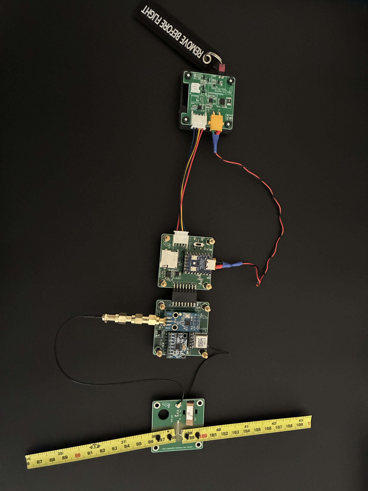
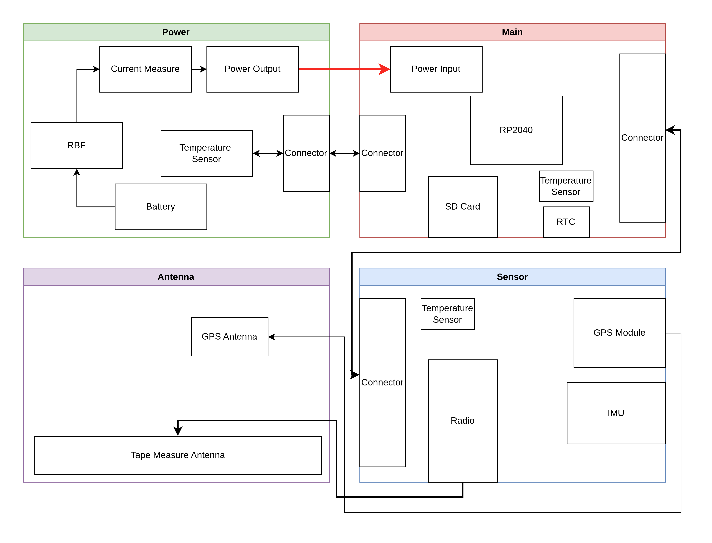

# TocoSat EBB

**WIP** - This project and documentation is a Work In Progress

The TocoSat Elegant Breadboard is a proof of concept design for the further development of the TocoSat PocketQube. This design focuses primarily on components and modules I have personally used before and am familiar with. 

This project is to get familiar with designing a spacecraft systems as a whole and getting familiar with the software design and structure. The software aspect is more about designing a whole satellite system, with TM/TC rather than learning the specific ICs and components for the final version of TocoSat  as they are expected to change.

The system is based upon the RP2040 as the OBC. Again this is due to my own personal familiarity with the device. This is not the final uC chosen for Tocosat, but also tocosat may be deigned to work with a range of uCs.

  

# Design Overview
The EBB is broken into 4 main subsystems. Power, Main, Sensors and Antenna
### Power
This is the power board, responsible for the external power connection and monitoring of the system power draw. This PCB also includes a remove before flight switch, which once removed powers the system.
### Main
This is the OBC board, responsible for communicating with all of the subsystems and handling the telemetry and commands. This PCB also includes a power switch for the subsystem, once the RBF tag is removed.
### Sensors
This PCB houses an IMU, Radio and GPS module. The antennas for the Radio and GPS and routed off board.
### Antenna
This PCB accepts the RF connection from the radio and is also used to attach a GPS patch antenna. The antenna used for the RF system is a simple dipole antenna made from a tape measure and is soldered and connected to the antenna PCB.

Here is a simple block diagram overview of the system.

  

  

